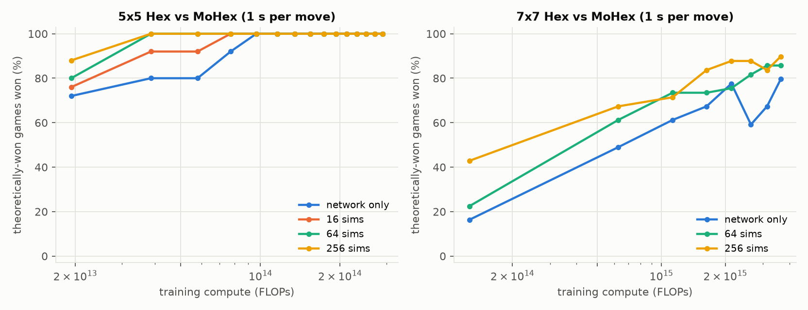
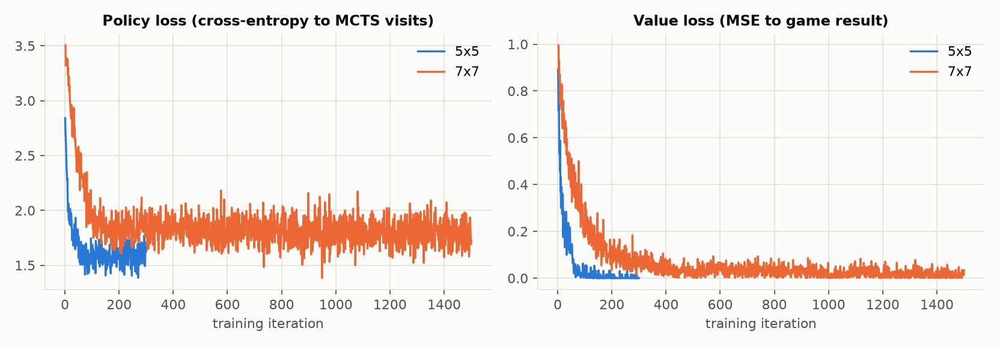

# AlphaZero for Hex, from scratch

I wanted to really understand AlphaZero, so I built it from scratch in JAX and taught it to play Hex by playing against itself. No hand-written strategy, no GPU, everything here was trained on my MacBook Air M1.

The idea comes from Andy Jones's paper *Scaling Scaling Laws with Board Games* (2021), which studied AlphaZero on
small Hex boards. Small boards are nice because they're **solved**, so instead of saying "it wins a lot" you can check
whether the agent actually plays perfectly. I used [MoHex 2.0](https://github.com/cgao3/benzene-vanilla-cmake), a
former Computer Olympiad champion, both as the opponent and, through its exact solver, as the referee.

**[Play against it in your browser](https://levi0p.github.io/hex/)** (or open `web/index.html` locally)

## How did it do?

For every board, I force Black's first move onto each cell and play two games against MoHex, one with my agent on each
side. MoHex's solver knows who should win each opening, so the bar is simple: **win every game that's theoretically
yours**. I also had the solver check every single move: whenever the agent could force a win, did its move keep it?

| Board | Training time | What I tested | Result |
|---|---|---|---|
| 3x3 | 5 min | every possible game, both sides | **perfect**, 0 mistakes in 305 positions |
| 5x5 | 28 min | all 25 openings x 2 sides vs MoHex (10 s/move) | **won 25 / 25** of the games it should win, kept the win in 159 / 159 positions |
| 5x5 | | 200 games vs an erratic opponent (30% random moves) | kept the win in 823 / 824 positions, and 800 / 800 with more search |
| 7x7 | 7.9 h | all 49 openings x 2 sides vs MoHex (1 s/move), 800 sims | won 45 / 49, kept the win in **768 / 774** positions (99.2%) |

So: perfect on 3x3, matches MoHex on 5x5, and very strong but not perfect on 7x7. As Black it still loses the c2
opening (and its mirror image e6). Its first move after MoHex's reply is already wrong, and giving it 4x more search
doesn't help, so that's something the network just hasn't learned yet. More training would probably fix it; I stopped
here. One caveat on the 7x7 games: I gave MoHex 1 second per move there (10 seconds would have taken most of a day),
and 1-second MoHex sometimes loses games it should win, so the solver-checked number is the one I trust.

## Two things I learned the hard way

**The agent only knows the openings it practises.** My first 5x5 agent kept losing the same four openings, no matter
how long I trained it. Self-play always opened with moves it liked, so it had never seen what comes after weird first
moves like e2. Making the first move random in half of the self-play games fixed it:

| 5x5 vs MoHex (10 s/move) | Games won that it should win |
|---|---|
| no random first moves | 21 / 25 |
| random first move in half the games | **25 / 25** |

**Don't trust the referee blindly.** I first labelled openings with MoHex's `dfpn-solver-find-winning` command, which
sounds like "list every winning move". It isn't: it skips winning moves it can prove are "dominated" by another move.
On 7x7 it listed 13 winning openings; solving each one directly with `dfpn-solve-state` gives 27. I only noticed
because the agent seemed to be winning games it "should" lose, and because the list wasn't symmetric under a 180°
rotation, which it has to be in Hex. There's a test for this now.

## Thinking longer vs training longer



This is the small version of Andy Jones's main result: more search when playing can make up for less training. On
5x5, with 256 simulations per move the agent wins all 25 should-win games after 40 training iterations; using just
the network it needs 100. (These curves use MoHex at 1 s per move.)



## What's in the repo

The learning part is about 580 lines and it's all hand-written. MoHex is only used for testing.

| File | What it does |
|---|---|
| `hexaz/hex.py` | Hex rules in JAX. The board is always stored from the view of the player to move, flipped after each move, so the network only ever sees "my turn, I connect top to bottom". |
| `hexaz/mcts.py` | Batched MCTS (PUCT). All games search together, so each simulation is one network call. |
| `hexaz/net.py` | A small ResNet with a policy head and a value head. Fully convolutional, so it works on any board size. |
| `hexaz/selfplay.py` | Self-play, labelling positions with the final result, the replay buffer, 180° rotation augmentation. |
| `hexaz/train.py` | The loop: self-play, train, checkpoint, repeat. |
| `hexaz/solver.py`, `hexaz/evaluate.py` | An exact solver for 3x3 and the exhaustive perfect-play check. |
| `hexaz/mohex.py`, `hexaz/arena.py`, `hexaz/sweep.py` | Talking to MoHex, the opening tests, the referee, and the strength-over-training experiment. |
| `hexaz/plots.py`, `hexaz/export_web.py`, `web/` | The plots and the browser version (the same network and search, rewritten in JavaScript). |
| `tests/` | Rules vs a plain-Python reference, MCTS vs the exact solver, JavaScript vs JAX, the MoHex bridge. |
| `results/` | The raw file behind every number above. |

## Running it

```bash
uv venv --python 3.12 .venv && uv pip install --python .venv/bin/python "jax[cpu]" flax optax pytest numpy matplotlib
.venv/bin/python -m pytest -q tests/

# training (3x3 takes a few minutes, 5x5 about half an hour, 7x7 about 8 hours on an M1 Air)
.venv/bin/python -m hexaz.train --size 3 --iters 150 --eval-every 25
.venv/bin/python -m hexaz.train --size 5 --channels 32 --blocks 3 --games 256 --sims 64 --moves 16 --steps 100 --buffer 200000 --iters 300 --eval-every 20
.venv/bin/python -m hexaz.train --size 7 --channels 32 --blocks 4 --games 256 --sims 64 --moves 16 --steps 100 --buffer 300000 --iters 1000 --eval-every 50
.venv/bin/python -m hexaz.train --size 7 --channels 32 --blocks 4 --games 256 --sims 64 --moves 16 --steps 100 --buffer 300000 --iters 500 --eval-every 50 --lr 3e-4 --resume --out runs/hex7_seed0

# testing against MoHex (see below for building it)
.venv/bin/python -m hexaz.arena --run runs/hex5_seed0 --sims 64 --referee
.venv/bin/python -m hexaz.arena --run runs/hex5_seed0 --sims 256 --mohex-time 1 --exam 200
.venv/bin/python -m hexaz.sweep --run runs/hex5_seed0 --sims 0 16 64 256
.venv/bin/python -m hexaz.plots runs/hex5_seed0 runs/hex7_seed0

# browser version
.venv/bin/python -m hexaz.export_web --run runs/hex5_seed0
.venv/bin/python -m hexaz.export_web --run runs/hex7_seed0
```

**Building MoHex on an M1 Mac.** Clone `cgao3/benzene-vanilla-cmake`. It needed two fixes for current Homebrew
libraries. First, newer Boost removed `path::normalize()`, `branch_path()` and `native_file_string()`, so in
`src/util/Misc.cpp` use `lexically_normal()`, `parent_path()` and `string()`, and accept `BOOST_FILESYSTEM_VERSION >= 3`.
Second, macOS ships an old BSD `db.h` that hides Berkeley DB, so add
`include_directories(BEFORE /opt/homebrew/opt/berkeley-db@5/include)` and
`link_directories(/opt/homebrew/opt/berkeley-db@5/lib)` to the top-level `CMakeLists.txt`. Then `cmake .. && make mohex`,
and copy `build/src/mohex/mohex` and `share/*.txt` into `third_party/`.
